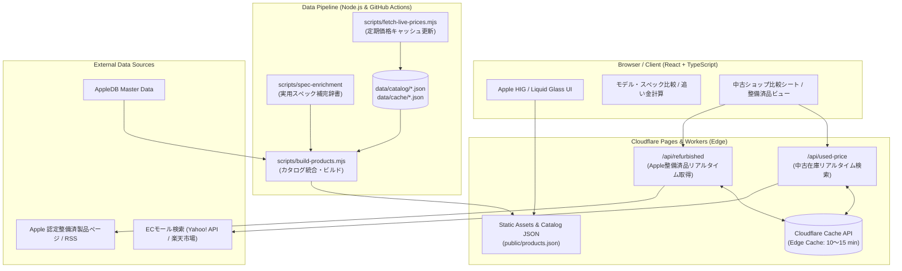

# Apple Price Atlas

**歴代Apple製品のスペック・キャリア価格・中古相場・価格改定の完全比較データベース**

[](https://react.dev/)
[](https://www.typescriptlang.org/)
[](https://vitejs.dev/)
[](https://tailwindcss.com/)
[](https://pages.cloudflare.com/)
[](https://github.com/features/actions)

🔗 **Live Demo:** [https://apple.azarin.me](https://apple.azarin.me)

---

## 概要・開発背景

Apple製品（iPhone / iPad / Mac / Apple Watch / AirPods）を購入・比較する際、「Apple Store直販の新品定価」「主要4キャリアの実質負担額（2年返却・MNP割引）」「Apple認定整備済品の在庫」「中古・未使用品の市場最安値」「発売時の為替レート推移」はそれぞれ別々のサイトに分散しています。さらに、「同じUSB-C端子でも転送速度が480Mbpsか10Gbpsか」「日本国内版で物理SIMが入るかeSIM専用か」といった実用上の重要なスペック差が一覧しづらいという課題がありました。

**Apple Price Atlas** は、これらすべての価格情報と30項目以上の詳細スペックを1つの画面に統合し、今どのモデルをどのルートで買うのが最も合理的かを瞬時に判断できるオールインワン比較プラットフォームです。

---

## 主な機能

### 1. モデル横断比較（詳細スペック ＆ 4キャリア価格）
- **全6カテゴリ・32項目の詳細スペック比較**: AppleDB由来の内部仕様（内部識別子・モデル番号・ボードID・製造プロセス・SoC構成）と、独自整備した実用スペック辞書（最大輝度・120Hz ProMotion・USB転送速度・外部モニター出力・SIM/eSIM仕様・Apple Intelligence対応状況など）を統合表示。
- **キャリア実質負担・MNP割引シミュレーション**: Apple Store直販および主要4キャリア（docomo / au / SoftBank / 楽天モバイル）の「一括価格」「2年返却（実質負担額）」「MNP/新規割引」をワンタップで切り替え、最安ルートを自動ハイライト。
- **差分フィルター ＆ 非該当項目の自動最適化**: 比較中のモデル間で違いがある行だけを抽出する「差分のみ表示」や、比較対象すべてで非該当となる項目（Mac比較時のSIM仕様など）を自動で隠すスマートテーブル機能を搭載。
- **予算から逆算検索**: 予算上限や条件を指定して、新品・中古・2年返却それぞれの枠内で狙える最適モデルを逆引き。

### 2. 下取り・買い替え追い金シミュレーター
- 現在使用している機種・容量と売却ルート（フリマ出品 / 中古買取店舗 / Apple公式下取り）を選択するだけで、比較中の各モデルへ乗り換えた際の「実質追い金」と「スペック進化点」をリアルタイムに算出。

### 3. 中古・未使用品ショップ横断比較（リアルタイム取得）
- **ハイブリッド在庫検索エンジン**: モール横断で現在出品されている中古・未使用品の在庫リストを安い順でリアルタイムに取得。
- **厳密タイトル検証フィルタ**: 独自の正規表現クレンジングにより、ケース・フィルム・互換パーツ・ジャンク品・別容量・別モデル（Pro / Max / mini / Plus 等の誤混入）を自動除外。商品タイトルから「状態ランク（未使用品 / Aランク / Bランク / Cランク）」および「SIMフリー有無」を自動判定。
- **リセール残価率の可視化**: 新品定価（終売モデルは最終定価）に対する現在の中古最安値の残価率・価格差を自動計算。

### 4. Apple認定整備済品リアルタイム比較
- Apple公式の認定整備済製品データおよびフィードから現在の実在庫・価格をリアルタイム取得。
- 製品カタログと自動名寄せ（マッチング）を行い、「新品定価からの割引額・割引率」と「現在の中古市場最安値との差額」を横並びで比較。

### 5. 価格タイムライン ＆ 発売時×為替レート分析
- 歴代モデルの日本国内における価格改定（為替変動に伴う値上げ・新機種登場時の値下げ）の履歴をタイムラインで可視化。
- 米国発売価格（USD）に対する当時の実勢為替レートとApple設定レート（Appleレート）の乖離を分析。

### 6. マルチフォーマット出力・共有
- 比較カードおよびスペック表の **画像保存（PNG）**・**クリップボードへの画像コピー** に対応。
- 比較状態を保持した共有URL発行、X（旧Twitter）への直接ポスト、**Excel / Markdown / CSV** 形式でのデータエクスポートに対応。

---

## UI/UX 設計思想（Apple HIG & Liquid Glass Design）

- **ソフトコントラスト・ライトモード設計**: 長時間スペック表や数字を見比べても眼精疲労（ハレーション）を起こさないよう、Apple公式サイト（`apple.com/jp`）にならった `#f5f5f7` ベースのオフホワイト配色と `tabular-nums`（等幅数字）タイポグラフィを採用。
- **Liquid Glass マテリアル**: ナビゲーションバー、スクロール追従（Sticky）ヘッダー、ボトムシートに多層スペキュラーハイライト（`inset box-shadow`）と高彩度バックドロップブラー（`backdrop-filter: blur() saturate()`）を組み合わせた光学ガラス質感を適用。
- **モバイルファーストの「2列固定比較」とネイティブ操作感**:
  - スマートフォン表示時は、横スクロールや文字潰れを一切発生させない「2列固定並列レイアウト（項目名を上段全幅・各機種の値を下段2列に配置）」へ自動変形。
  - 中古ショップ比較シートはタッチジェスチャー（下方向へのスワイプ引き下げ）による直感的な開閉に対応。

---

## システムアーキテクチャ



### 技術的なこだわり
1. **ビルド時データ統合とエッジAPIのハイブリッド構成**
   - 基礎スペックやカタログ構造はビルド時に `appledb-main.json` と独自のスペック補完辞書をマージして静的JSON（`products.json`）へコンパイルし、初期表示を高速化。
   - 一方で変動の激しい「中古ショップ別の出品在庫」や「Apple認定整備済品の在庫」は Cloudflare Pages Functions（Workers）からオンデマンドで取得するハイブリッド設計を採用。
2. **Cloudflare Cache API によるエッジキャッシュ制御**
   - `/api/used-price`（10分間：`s-maxage=600`）および `/api/refurbished`（15分間：`s-maxage=900`）において正規化したクエリ単位で Cloudflare のエッジキャッシュを適用。外部APIのレート制限を回避しつつ、2回目以降のリクエストにミリ秒単位で応答。
3. **堅牢なリンク正規化エンジン**
   - 各モールの商品URL・検索URLをアフィリエイト経由に変換する際、既存ラップURLの展開や二重URLエンコード防止チェック（`src/utils/moshimo.ts`）を一元化し、iOS Safari等でのリダイレクトエラーを防止。

---

## ディレクトリ構成

```text
├── .github/
│   └── workflows/
│       └── update-prices.yml    # 定期価格取得・データ更新ワークフロー
├── data/
│   ├── catalog/                 # カテゴリ別の製品カタログJSON (iPhone, Mac, iPad 等)
│   └── cache/                   # AppleDBデータおよび価格キャッシュJSON
├── functions/
│   └── api/
│       ├── used-price.js        # 中古在庫ランキング取得 Worker (Edge Cache対応)
│       └── refurbished.js       # Apple認定整備済品リアルタイム取得 Worker
├── public/                      # ビルド済み配信用JSON (products.json 等)・静的アセット
├── scripts/
│   ├── build-products.mjs       # カタログ・AppleDB・スペック辞書の統合ビルドスクリプト
│   └── fetch-live-prices.mjs    # 市場最安値・価格キャッシュ更新バッチスクリプト
└── src/
    ├── components/              # 各機能ビュー・モーダルコンポーネント
    ├── utils/                   # URL正規化・アフィリエイト変換等の共通ユーティリティ
    ├── usedPrice.ts             # フロントエンド側の中古価格取得・フィルタ処理
    ├── App.tsx                  # アプリケーションルート・状態管理
    └── main.tsx                 # エントリーポイント
```

---

## ローカル開発・セットアップ手順

### 1. 必要環境
- Node.js 18.x 以上
- npm

### 2. パッケージのインストール
```bash
npm install
```

### 3. 環境変数の設定
プロジェクトルートに `.env` ファイルを作成し、以下の環境変数を設定します（未設定の項目があってもフォールバックにより動作します）。

```env
# Yahoo!ショッピングAPI アプリケーションID
YAHOO_CLIENT_ID=your_yahoo_client_id

# もしもアフィリエイト 提携ID（サーバーサイド / バッチ用）
MOSHIMO_RAKUTEN_AID=your_rakuten_aid
MOSHIMO_YAHOO_AID=your_yahoo_aid
MOSHIMO_AMAZON_AID=your_amazon_aid

# もしもアフィリエイト 提携ID（フロントエンド用）
VITE_MOSHIMO_RAKUTEN_AID=your_rakuten_aid
VITE_MOSHIMO_YAHOO_AID=your_yahoo_aid
VITE_MOSHIMO_AMAZON_AID=your_amazon_aid

# オプション: 検索データ取得用中継プロキシURL
RAKUTEN_PROXY_URL=
```

### 4. カタログデータのビルドと開発サーバー起動
```bash
# カタログ・スペックデータの統合ビルド (public/products.json 等の生成)
npm run build:data

# ローカル開発サーバーの起動
npm run dev

# 本番用ビルド
npm run build
```

---

## Author

**あざりん (Azarin)**
- **Web / Portfolio:** [https://azarin.me](https://azarin.me)
- **Service URL:** [https://apple.azarin.me](https://apple.azarin.me)
- **YouTube:** [@azarin_official](https://www.youtube.com/@azarin_official) / [@azarin_official_gajyettoch](https://www.youtube.com/@azarin_official_gajyettoch)

---

## 免責事項・ライセンス

- 当サイトおよびリポジトリに記載されている製品名、ロゴ、ブランド等は Apple Inc. および各社の商標または登録商標です。
- 表示される価格・在庫・実質負担額・下取り額等の情報は取得時点の参考値です。最新の正確な価格および契約条件については、必ず Apple 公式サイトおよび各キャリア・各販売ショップのページにてご確認ください。
- License: MIT License
