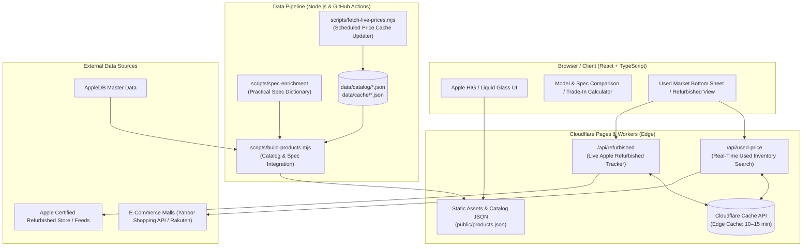

# Apple Price Atlas

**Comprehensive Comparison Database for Apple Specs, Carrier Pricing, Used Market, and Price History**

[](https://react.dev/)
[](https://www.typescriptlang.org/)
[](https://vitejs.dev/)
[](https://tailwindcss.com/)
[](https://pages.cloudflare.com/)
[](https://github.com/features/actions)
[](./LICENSE)

🔗 **Live Demo:** [https://apple.azarin.me](https://apple.azarin.me)

---

## Overview & Background

When comparing and purchasing Apple products (iPhone, iPad, Mac, Apple Watch, AirPods) in Japan, critical pricing data—such as Apple Store retail prices, carrier installment/return programs across the 4 major carriers (docomo, au, SoftBank, Rakuten Mobile), Apple Certified Refurbished stock, used market prices, and historical exchange rate trends—is scattered across multiple websites. Furthermore, practical hardware differences (e.g., whether a USB-C port supports 480Mbps USB 2 or 10Gbps USB 3, or whether a Japanese model supports a physical nano-SIM or is dual-eSIM only) are often difficult to compare side by side.

**Apple Price Atlas** unifies real-time market pricing and 30+ granular technical specifications into a single platform, enabling users to immediately identify the most cost-effective model and purchasing route.

---

## Key Features

### 1. Cross-Model Comparison (32+ Specs & 4-Carrier Pricing)
- **6 Categories / 32+ Detailed Specifications**: Merges internal hardware data from AppleDB (Identifiers, Model Numbers, Board IDs, lithography process, SoC configurations) with a curated practical spec dictionary (peak brightness, 120Hz ProMotion, USB data transfer speeds, external display support, SIM/eSIM specs, Apple Intelligence compatibility, etc.).
- **Carrier Net Cost & MNP Discount Simulation**: Instantly toggle between full retail price, 2-year return program net cost, and MNP/new contract discounts across Apple Store and Japan's 4 major carriers, automatically highlighting the lowest price.
- **Smart Diff Filter & Auto-Row Pruning**: Features a "Show Differences Only" toggle and automatically hides spec rows that do not apply to any currently selected models (e.g., hiding SIM specs when comparing Macs).
- **Reverse Budget Search**: Filter and discover optimal models based on a target budget across new, used, and 2-year carrier return options.

### 2. Trade-In & Upgrade Net Cost Simulator
- Select your current device, storage capacity, and selling route (flea market app, used shop buyback, or Apple Trade In) to calculate the exact net upgrade cost and spec improvements for every compared model.

### 3. Real-Time Used & Unused Market Comparison
- **Hybrid Inventory Search Engine**: Fetches real-time listings across major Japanese e-commerce malls, ranked from lowest to highest price.
- **Strict Title Validation Filter**: Uses custom regex cleansing to automatically exclude cases, screen protectors, replacement parts, junk items, mismatched storage capacities, and different sub-models (Pro / Max / mini / Plus). Automatically detects item condition (Unused / Grade A / B / C) and SIM-free status from listing titles.
- **Resale Value Retention**: Automatically calculates the resale value percentage and price difference relative to the original or final Apple Store retail price.

### 4. Real-Time Apple Certified Refurbished Tracker
- Fetches live inventory and pricing directly from Apple Certified Refurbished feeds.
- Automatically matches refurbished listings with catalog SKUs to compare discounts against both original retail prices and current used market lows.

### 5. Price Revision Timeline & Launch FX Analysis
- Visualizes historical domestic price revisions (price hikes and drops) across generations.
- Analyzes the divergence between US launch prices (USD), historical market exchange rates, and Apple's implied JPY exchange rates.

### 6. Multi-Format Export & Sharing
- Export comparison cards and spec tables directly as **PNG images** (download or copy to clipboard).
- Generate shareable comparison URLs, post directly to X (formerly Twitter), or export tables to **Excel, Markdown, and CSV**.

---

## UI/UX Design Philosophy (Apple HIG & Liquid Glass Design)

- **Soft-Contrast Light Mode**: Built around Apple's signature `#f5f5f7` off-white palette and `tabular-nums` typography to prevent eye strain during dense spec and price comparisons.
- **Liquid Glass Material**: Applies multi-layered specular highlights (`inset box-shadow`) and high-saturation backdrop blur (`backdrop-filter: blur() saturate()`) to navigation docks, sticky headers, and bottom sheets.
- **Mobile-First 2-Column Layout & Native Gestures**:
  - On mobile viewports, the table dynamically restructures into a zero-horizontal-scroll **2-column side-by-side layout** (full-width spec label row above a 2-column value grid).
  - The used shop comparison modal functions as a native-style bottom sheet supporting touch swipe-down gestures to dismiss.

---

## System Architecture



### Technical Highlights
1. **Build-Time Data Integration + On-Demand Edge APIs**
   - Static hardware specs and catalog structures are compiled at build time by merging `appledb-main.json` with a custom enrichment dictionary into `products.json` for instant initial rendering.
   - Volatile data—such as individual used shop listings and live refurbished stock—is fetched on demand via Cloudflare Pages Functions (Workers).
2. **Edge Caching with Cloudflare Cache API**
   - `/api/used-price` (`s-maxage=600`) and `/api/refurbished` (`s-maxage=900`) cache normalized query responses at the Cloudflare edge, preventing upstream rate limits while delivering millisecond responses on subsequent requests.
3. **Idempotent Affiliate URL Normalization**
   - Centralizes link wrapping (`src/utils/moshimo.ts`) with automatic unwrapping of existing redirect URLs and safeguards against double URL encoding (`encodeURIComponent`), preventing redirect errors on iOS Safari.

---

## Directory Structure

```text
├── .github/
│   └── workflows/
│       └── update-prices.yml    # Scheduled price & catalog update workflow
├── data/
│   ├── catalog/                 # Category-based product catalog JSONs (iPhone, Mac, iPad, etc.)
│   └── cache/                   # AppleDB master data & cached price JSONs
├── functions/
│   └── api/
│       ├── used-price.js        # Used market ranking Worker (with Edge Cache)
│       └── refurbished.js       # Apple Certified Refurbished live parser Worker
├── public/                      # Compiled static JSONs (products.json) & assets
├── scripts/
│   ├── build-products.mjs       # Build script merging catalogs, AppleDB, and spec dictionary
│   └── fetch-live-prices.mjs    # Batch script for updating lowest market price caches
└── src/
    ├── components/              # Feature views & modal components
    ├── utils/                   # URL normalization, affiliate link conversion, shared utilities
    ├── usedPrice.ts             # Client-side used price fetcher & title filtering logic
    ├── App.tsx                  # Application root & state management
    └── main.tsx                 # Entry point
```

---

## Getting Started

### 1. Prerequisites
- Node.js 18.x or higher
- npm

### 2. Installation
```bash
npm install
```

### 3. Environment Variables
Create a `.env` file in the project root and configure the following variables (all affiliate/proxy variables are optional and safely fall back to direct links if omitted):

```env
# Yahoo! Shopping API Client ID
YAHOO_CLIENT_ID=your_yahoo_client_id

# Moshimo Affiliate IDs (Server-side / Batch scripts)
MOSHIMO_RAKUTEN_AID=your_rakuten_aid
MOSHIMO_YAHOO_AID=your_yahoo_aid
MOSHIMO_AMAZON_AID=your_amazon_aid

# Moshimo Affiliate IDs (Frontend)
VITE_MOSHIMO_RAKUTEN_AID=your_rakuten_aid
VITE_MOSHIMO_YAHOO_AID=your_yahoo_aid
VITE_MOSHIMO_AMAZON_AID=your_amazon_aid

# Optional: Proxy URL for search data fetching
RAKUTEN_PROXY_URL=
```

### 4. Build Catalog Data & Run Dev Server
```bash
# Build integrated catalog & spec data (generates public/products.json)
npm run build:data

# Start local development server
npm run dev

# Build for production
npm run build
```

---

## Author

**Azarin (あざりん)**
- **Web / Portfolio:** [https://azarin.me](https://azarin.me)
- **Service URL:** [https://apple.azarin.me](https://apple.azarin.me)
- **YouTube:** [@azarin_official](https://www.youtube.com/@azarin_official) / [@azarin_official_gajyettoch](https://www.youtube.com/@azarin_official_gajyettoch)

---

## Disclaimer & License

- Apple, iPhone, iPad, Mac, Apple Watch, AirPods, and other product names and logos referenced in this project are trademarks or registered trademarks of Apple Inc.
- All prices, stock statuses, carrier program calculations, and trade-in estimates are provided for reference at the time of retrieval. Always verify final pricing and contract terms on the official Apple website, carrier stores, or respective retail shops.
- This project is licensed under the [MIT License](./LICENSE).
